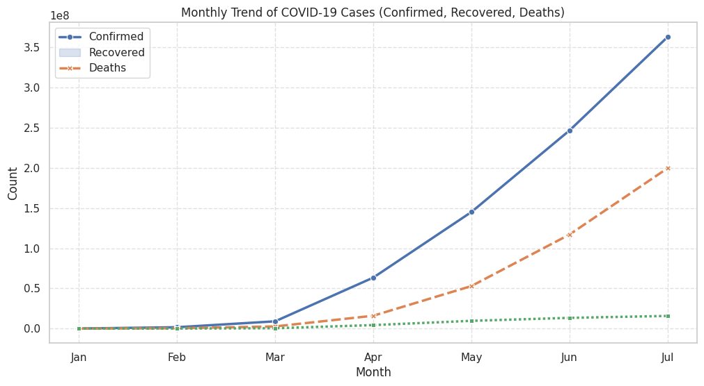
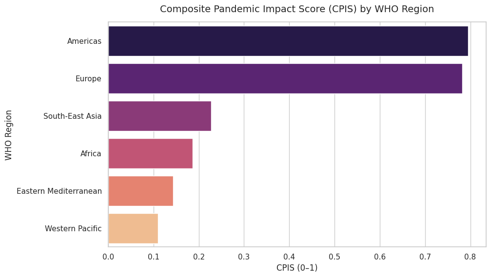
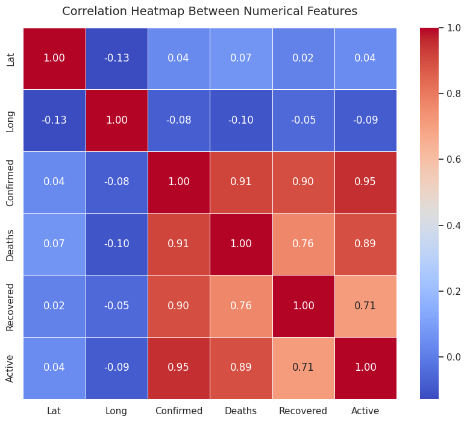
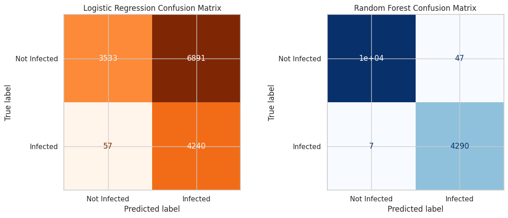
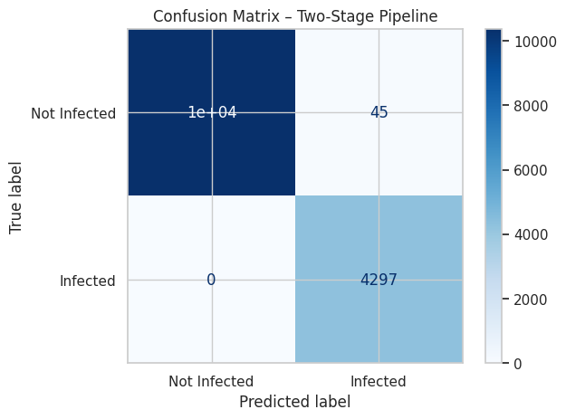
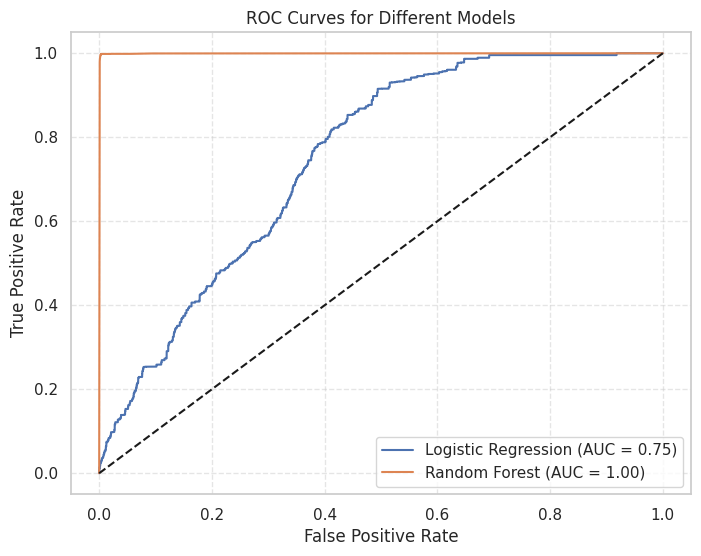

# COVID-19 Case Prediction Using Machine Learning

**Abdulhamid Alaboud · Ahmed Alaglan**

## Overview
A supervised machine learning and exploratory data analysis (EDA) pipeline built on global COVID-19 epidemiological records (`covid_19_clean_complete.csv`). The notebook explores WHO-region infection dynamics, introduces a **Composite Pandemic Impact Score (CPIS)** for regional severity comparison, and benchmarks **Logistic Regression**, **Random Forest**, and a two-stage hybrid pipeline under class-imbalance resampling (`SMOTE` and `RandomUnderSampler`).

---

## Problem Formulation & Features
- **Dataset Source:** [Corona Virus Report on Kaggle](https://www.kaggle.com/datasets/imdevskp/corona-virus-report) (public Kaggle epidemiological dataset; follow Kaggle's dataset license terms for redistribution).
- **Input Features (`X`):** `Confirmed`, `Deaths`, `Recovered`, `Lat`, `Long`.
- **Binary Target (`y`):** `Infected_encoded` derived from `Active > 0` (`Not Infected` when `Active == 0`, otherwise `Infected`).
- **Regional Metric (`CPIS`):** Weighted min–max normalized composite of fatality severity (`0.4`), recovery weakness (`0.3`), and cumulative spread (`0.3`) aggregated by WHO Region.

---

## Evaluation Protocol
1. **Train / Test Split:** `70%` Training / `30%` Testing (`train_test_split(..., test_size=0.3, random_state=42)`).
2. **Class Imbalance Handling:** Evaluated `SMOTE` oversampling and `RandomUnderSampler` on the training split prior to model fitting.
3. **Models Evaluated:**
   - `LogisticRegression(random_state=42)`
   - `RandomForestClassifier(n_estimators=100, class_weight='balanced', random_state=42)`
   - Two-stage Logistic Regression → Random Forest routing experiment.
4. **Metrics Tracked:** Accuracy, Precision, Recall, F1-Score, Confusion Matrix, and ROC-AUC.

### Reported Notebook Benchmark (Two-Stage Experiment)
- **Accuracy:** `99.69%` | **Precision:** `98.96%` | **Recall:** `100.00%` | **F1-Score:** `99.48%`

---

## Visual Analysis & Model Diagnostics

### Exploratory Data Analysis & CPIS Regional Severity
<p align="center">
  
</p>
<p align="center">
  
</p>
<p align="center">
  
</p>

### Classification Confusion Matrices & ROC-AUC Comparison
<p align="center">
  
</p>
<p align="center">
  
</p>
<p align="center">
  
</p>

---

## Methodological Audit & Known Limitations
In the interest of rigorous ML engineering, high headline accuracy (`99.69%`) should be interpreted alongside three structural caveats present in the original notebook implementation:
1. **Target–Feature Algebraic Coupling:** In `covid_19_clean_complete.csv`, `Active = Confirmed - Deaths - Recovered`. Because `Confirmed`, `Deaths`, and `Recovered` are included in `X` while `y` encodes `Active > 0`, the classification boundary is nearly deterministic rather than a forecasting task.
2. **Pre-Split Feature Scaling:** `StandardScaler().fit_transform(X)` is applied across the full feature matrix prior to `train_test_split`, introducing minor distributional leakage from the test set into the scaler statistics.
3. **Oracle Routing in Stage 2:** The two-stage routing cell routes samples using `mis_idx = stage1_pred != y_test`, which checks ground-truth test labels rather than a deployable confidence threshold (e.g., routing uncertain predictions where `0.3 < P(y=1|x) < 0.7`).

**Planned Refactor:** Wrap scaling, resampling (`imblearn.pipeline.Pipeline`), and confidence-based Stage-2 routing strictly inside cross-validated training folds, and reformulate the target as a forward time-lag prediction (`t + 7 days`) to evaluate genuine temporal generalization.

---

## Repository Structure
```text
Covid19-Case-Prediction/
├── Covid_19_Case_Prediction.ipynb  # Full EDA, CPIS metric, and ML evaluation notebook
├── requirements.txt                # Reproducible Python dependencies
├── data/
│   └── .gitkeep                    # Place covid_19_clean_complete.csv here
├── LICENSE                         # MIT License
└── README.md                       # Documentation & methodological audit
```

---

## Installation & Usage
```bash
git clone https://github.com/Abdulhamid-Alaboud/Covid19-Case-Prediction.git
cd Covid19-Case-Prediction
pip install -r requirements.txt
# Download covid_19_clean_complete.csv from Kaggle into ./data/
jupyter notebook Covid_19_Case_Prediction.ipynb
```

## License
MIT License — see [LICENSE](LICENSE) for details.
